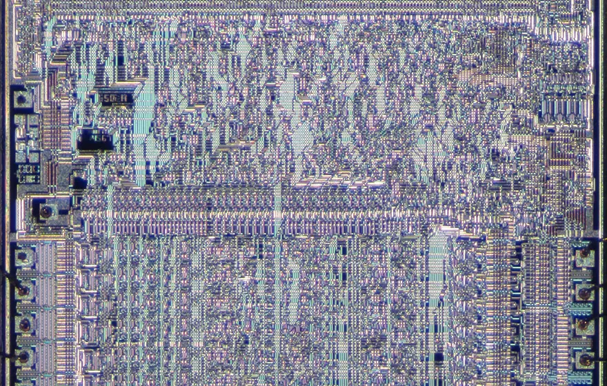

ShanghaiTech IC Wiki

# 上科大芯知库

上海科技大学学生发起的集成电路知识社区。在这里找一条学习路线，了解校内科研方向，或把一次工程实践写给后来的人。

[查看学习地图](learning/index.md){ .md-button .md-button--primary }
[参与共建](community/contributing.md){ .md-button }

<figure class="wiki-die" markdown>

</figure>

## 知识导航

-   :material-chip: **[认识 IC](explore-ic/index.md)**

    从产业链与知识地图入手，了解集成电路有哪些研究方向。

-   :material-map-outline: **[学习地图](learning/index.md)**

    按基础、数字、模拟、器件、EDA 与体系结构查找学习路线。

-   :material-school-outline: **[上科大 IC](shanghaitech/index.md)**

    查阅校内课程、教师、课题组与 IC 荣誉项目的公开资料入口。

-   :material-memory: **[竞赛与项目](competitions/index.md)**

    查找赛事指南、工程项目与参赛者的实践复盘。

-   :material-microscope: **[科研探索](research/index.md)**

    从一个具体问题开始，学习查找论文、阅读文献与记录研究过程。

-   :material-briefcase-outline: **[升学与职业](career/index.md)**

    按国内升学、海外申请、实习与就业查找经验和准备材料。

-   :material-tools: **[工具与资源](tools/index.md)**

    查找 EDA（电子设计自动化）工具、开发环境与开源项目。

-   :material-account-group-outline: **[社区与共建](community/index.md)**

    认领待共建条目，推荐一项资源，或提交你的第一篇文章。

## 关于项目

本站由上海科技大学 IC 荣誉项目学生独立发起，内容由贡献者共同维护。文章代表各自作者的观点，校内课程、政策与招生信息以学校及院系的正式发布为准。

网站代码、配置与脚本采用 [MIT 许可]({{ repo_url }}/blob/main/LICENSE)，原创文章按 [CC BY 4.0]({{ repo_url }}/blob/main/LICENSE-CONTENT) 共享。第三方作品保留各自许可。首页使用 Pauli Rautakorpi 拍摄的 [MOS 6502 裸片照片](https://commons.wikimedia.org/wiki/File:MOS_6502_die.jpg)，采用 [CC BY 3.0](https://creativecommons.org/licenses/by/3.0/)，经裁切、缩放与转码。[项目 GitHub 仓库]({{ repo_url }})
